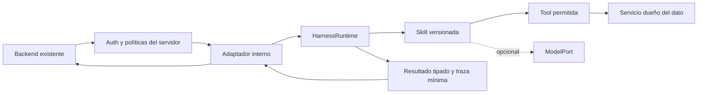

# HarnessOS

**Un runtime pequeño y reutilizable para ejecutar capacidades de IA con límites y controles explícitos.**

HarnessOS es una semilla de *harness engineering* en Rust. Se integra como biblioteca dentro de un backend Rust: organiza skills, herramientas permitidas, identidad verificada, presupuestos y resultados tipados. No es un sistema operativo, un servidor HTTP ni una plataforma autónoma.

| Estado | Stack | Ejemplo local | Uso previsto |
|---|---|---|---|
| Semilla experimental | Rust estable · Cargo | Sintético y offline | Aprender, probar contratos y adaptar detrás de un backend existente |

> [!WARNING]
> No uses la semilla directamente con datos personales, escolares, clínicos o financieros. La demo usa fixtures inventados y no se conecta a sistemas reales. El paquete todavía no está listo para producción.

## El flujo



El producto conserva sus rutas, DTO, autenticación, cuotas, streaming y persistencia. HarnessOS se ubica detrás de esa frontera y llama los servicios existentes mediante tools explícitas.

## Prueba en 2 comandos

Requiere Rust estable y Cargo. En la primera ejecución Cargo descarga las dependencias declaradas en `Cargo.lock`.

```bash
cargo run --release --locked --bin harnessos-demo
cargo test --locked
```

La demo imprime dos casos ficticios, respuestas, referencias `DEMO-` y el estado de verificación. El modelo predeterminado es determinista y está etiquetado como demo; no es un LLM.

Para revisar formato y tipos:

```bash
cargo fmt --check
cargo check --all-targets --locked
```

### Probar con Ollama (opcional)

Requiere Ollama corriendo en `localhost` y un modelo descargado por tu cuenta. La opción no se conecta a proveedores remotos.

```bash
# macOS / Linux
HARNESS_MODEL=ollama OLLAMA_MODEL=qwen3:4b-instruct cargo run --release --locked --bin harnessos-demo
```

```powershell
# Windows PowerShell
$env:HARNESS_MODEL = "ollama"
$env:OLLAMA_MODEL = "qwen3:4b-instruct"
cargo run --release --locked --bin harnessos-demo
```

## Qué incluye

- `HarnessRuntime`: valida el principal, skill, scopes, argumentos, tools permitidas, presupuesto y timeout.
- `Registry`: resuelve skills por `id@version` y tools por identificador.
- `knowledge.retrieve`: recupera evidencia sin llamar un modelo.
- `knowledge.answer`: genera una respuesta mediante un `ModelPort` y devuelve fuentes.
- `DemoModel`: respuesta determinista para desarrollo offline. `OllamaModel`: opción local explícita.
- Fixtures multi-tenant y `EphemeralMemory`: ejemplos volátiles, no persistencia. El almacén limita entradas y bytes por instancia.
- `HarnessRuntime`: usa por defecto 8 workers reutilizables con stack solicitado de 256 KiB; `RuntimeConfig` ajusta concurrencia, stack y estimaciones máximas de entrada (1 MiB), resultado de tool (4 MiB) y salida (4 MiB).

La salida generativa declara `verified: false`: las fuentes citadas no prueban por sí solas que una respuesta sea correcta.

El runtime asigna memoria al necesitarla; no reserva automáticamente toda la RAM libre. Los límites JSON son estimaciones de memoria en las fronteras del runtime, no un hard cap de RSS ni un sandbox para allocations internas de tools/proveedores. El operador configura límites de memoria y concurrencia según el host, otras cargas y el SLO. La memoria efímera no es adecuada para datos reales.

Para repetir la carga sintética de 10 000 consultas en cinco muestras:

```bash
cargo run --release --locked --bin harnessos-benchmark
```

La utilidad imprime tiempos y pausa unos segundos para permitir medir el working set con las herramientas del sistema. No representa una carga de producción.

## Reutilizarlo en otro proyecto

Empieza con la [guía de inicio rápido](docs/QUICKSTART.md). Explica cómo ejecutar el ejemplo y conectar el runtime detrás del backend existente. Para los controles de integración, consulta la [guía de adopción](docs/ADOPTION.md) y la [matriz de contrato](docs/CONSUMER_CONTRACT_TEMPLATE.md).

## Límites actuales

HarnessOS no aporta autenticación real, API HTTP/SSE, permisos de negocio, almacenamiento durable, RAG vectorial, colas, rutinas durables ni herramientas de escritura. No expongas `HarnessRuntime` directamente al cliente. El servidor debe construir `Principal` desde identidad autenticada y aplicar las políticas del dominio.

## Documentación

Abre el [índice de documentación](docs/INDEX.md) para elegir el siguiente paso:

| Quiero… | Lee… |
|---|---|
| Probarlo en local y entender la llamada | [Inicio rápido](docs/QUICKSTART.md) |
| Integrarlo detrás de un backend existente | [Adopción](docs/ADOPTION.md) |
| Entender piezas y límites | [Arquitectura](docs/ARCHITECTURE.md) |
| Revisar seguridad y riesgos pendientes | [Seguridad](docs/SECURITY.md) · [Riesgos](docs/RISKS.md) |
| Ver estado y próximos hitos | [Estado](docs/STATE.md) · [Roadmap](docs/ROADMAP.md) |

