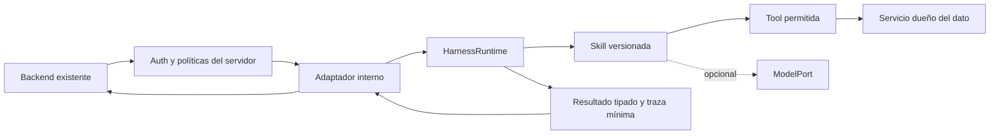

# HarnessOS

**Un runtime pequeño y reutilizable para ejecutar capacidades de IA con límites y controles explícitos.**

HarnessOS es una semilla de *harness engineering* en TypeScript. Se integra dentro del backend de cada producto: organiza skills, herramientas permitidas, identidad verificada, presupuestos y resultados tipados. No es un sistema operativo, un servidor HTTP ni una plataforma autónoma.

| Estado | Stack | Ejemplo local | Uso previsto |
|---|---|---|---|
| Semilla experimental | TypeScript · Node.js 22.10+ | Sintético y offline | Aprender, probar contratos y adaptar detrás de un backend existente |

> [!WARNING]
> No uses la semilla directamente con datos personales, escolares, clínicos o financieros. La demo usa fixtures inventados y no se conecta a sistemas reales. El paquete todavía no está listo para producción.

## El flujo



El producto conserva sus rutas, DTO, autenticación, cuotas, streaming y persistencia. HarnessOS se ubica detrás de esa frontera y llama los servicios existentes mediante tools explícitas.

## Prueba en 2 comandos

Requiere Node.js **22.10 o superior**. No hace falta instalar paquetes para ejecutar la demo ni las pruebas.

```bash
npm run demo
npm test
```

La demo imprime dos casos ficticios, respuestas, referencias `DEMO-` y el estado de verificación. El modelo predeterminado es determinista y está etiquetado como demo; no es un LLM. La prueba de humo ejecuta el script y comprueba que siga mostrando datos sintéticos y legibles.

Para comprobar tipos también, instala la única dependencia de desarrollo declarada y ejecuta:

```bash
npm install --no-audit --no-fund
npm run check
```

### Probar con Ollama (opcional)

Requiere Ollama corriendo en `localhost` y un modelo descargado por tu cuenta. La opción no se conecta a proveedores remotos.

```bash
# macOS / Linux
HARNESS_MODEL=ollama OLLAMA_MODEL=qwen3:4b-instruct npm run demo
```

```powershell
# Windows PowerShell
$env:HARNESS_MODEL = "ollama"
$env:OLLAMA_MODEL = "qwen3:4b-instruct"
npm run demo
```

## Qué incluye

- `HarnessRuntime`: valida el principal, skill, scopes, argumentos, tools permitidas, presupuesto y timeout.
- `Registry`: resuelve skills por `id@version` y tools por identificador.
- `knowledge.retrieve`: recupera evidencia sin llamar un modelo.
- `knowledge.answer`: genera una respuesta mediante un `ModelPort` y devuelve fuentes.
- `demoModel`: respuesta determinista para desarrollo offline. `createOllamaModel`: opción local explícita.
- Fixtures multi-tenant y `EphemeralMemory`: ejemplos de prueba, no persistencia.

La salida generativa declara `verified: false`: las fuentes citadas no prueban por sí solas que una respuesta sea correcta.

## Reutilizarlo en otro proyecto

Empieza con la [guía de inicio rápido](docs/QUICKSTART.md). Explica cómo ejecutar el ejemplo y conectar el runtime detrás del backend existente. Para los controles de integración, consulta la [guía de adopción](docs/ADOPTION.md) y la [matriz de contrato](docs/CONSUMER_CONTRACT_TEMPLATE.md).

## Límites actuales

HarnessOS no aporta autenticación real, API HTTP/SSE, permisos de negocio, almacenamiento durable, RAG vectorial, colas, rutinas durables ni herramientas de escritura. No expongas `HarnessRuntime` directamente al cliente. El servidor debe construir `Principal` desde identidad autenticada y aplicar las políticas del dominio.

## Documentación

Abre el [índice de documentación](docs/INDEX.md) para elegir el siguiente paso:

| Quiero… | Lee… |
|---|---|
| Probarlo en local y entender la llamada | [Inicio rápido](docs/QUICKSTART.md) |
| Integrarlo detrás de un backend existente | [Adopción](docs/ADOPTION.md) |
| Entender piezas y límites | [Arquitectura](docs/ARCHITECTURE.md) |
| Revisar seguridad y riesgos pendientes | [Seguridad](docs/SECURITY.md) · [Riesgos](docs/RISKS.md) |
| Ver estado y próximos hitos | [Estado](docs/STATE.md) · [Roadmap](docs/ROADMAP.md) |

