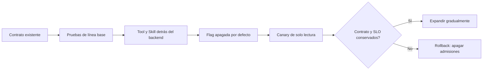

# Guía de adopción

[README](../README.md) · [Arquitectura](ARCHITECTURE.md)

Integra HarnessOS dentro del backend que ya existe. El backend sigue siendo responsable de identidad, permisos de negocio, transporte, cuotas y persistencia.

> **Regla de entrada:** empieza con una operación de solo lectura y un consumidor. No conectes herramientas de escritura ni crees un gateway nuevo para adoptar el runtime.

La implementación de este repositorio es una biblioteca Rust. Para integrarla directamente, el backend consumidor debe compilar Rust. Un consumidor en otro lenguaje necesitaría un adaptador o binding separado, con su propio contrato y decisión; esta semilla no agrega transporte ni altera rutas del producto.

## Antes de programar

Antes de integrar, registra en el repositorio consumidor la evidencia de compatibilidad:

- endpoint, DTO y validaciones;
- guards, fuente de identidad, tenant, roles y cuotas;
- status y cuerpo de errores, SSE, heartbeat, cancelación y jobs;
- efectos en bases de datos, logs, auditoría, retención y consumidores.

Captura casos de éxito y error con pruebas del producto. Usa fixtures sintéticos o anonimizados; no copies conversaciones ni documentos reales a HarnessOS.

## Camino de integración

| Paso | Trabajo | Criterio para avanzar |
|---|---|---|
| 1. Caracterizar | Fijar contratos actuales y sus pruebas | Éxito, validación, autorización, cuota y fallo están cubiertos |
| 2. Elegir | Seleccionar un caso existente y de solo lectura | Owner, objetivo y SLO acordados |
| 3. Adaptar | Conectar una `Tool` al servicio dueño de los datos y una `Skill` versionada | Schemas, scopes y allowlist tienen pruebas |
| 4. Autenticar | Construir `Principal` desde auth verificada y tenant resuelto en servidor | El cliente no puede elegir tenant, subject ni scopes |
| 5. Mapear | Traducir resultado/error al DTO y transporte actuales | No hay cambios visibles para los consumidores |
| 6. Comparar | Activar por flag y comparar resultados, errores, latencia y carga | Rollback probado y regresiones aceptables |

## Límites de responsabilidad

| Responsabilidad | Dueño |
|---|---|
| Autenticar usuario o servicio | Backend del producto |
| Resolver tenant, rol, ownership y permisos por objeto | Backend y servicio de dominio |
| Validar forma de entrada, scopes requeridos, tools disponibles y presupuesto máximo | HarnessOS |
| Ejecutar lectura autorizada | Tool que delega al servicio dueño del dato |
| Mantener rutas, DTO, SSE, cuotas, errores y persistencia | Backend del producto |
| Aprobar calidad, privacidad, retención y activación | Responsables del producto |

Una API key de servicio identifica una aplicación; por sí sola no identifica a una persona. No derives identidad personal desde una clave compartida. Los textos recuperados y resultados de tools son datos no confiables y nunca conceden permisos.

## Antes de habilitar escrituras

Las escrituras están fuera de la semilla actual. Antes de considerarlas, diseña autorización por operación y objeto, idempotencia durable, auditoría, transacciones o reconciliación, cancelación cooperativa y aprobación humana cuando corresponda. Reintentos y reinicios deben probarse sin duplicar efectos.

## Salida del piloto

Un piloto queda listo para decisión cuando presenta:

- pruebas de compatibilidad del producto y de permisos por tenant;
- evaluación de calidad y evidencia con fixtures no sensibles;
- mediciones de latencia, errores, costo y carga;
- política de logs, retención y borrado;
- owner, flag, canary y rollback ensayado.

Consulta [Seguridad](SECURITY.md) y [Roadmap](ROADMAP.md) para los controles y gates pendientes.
