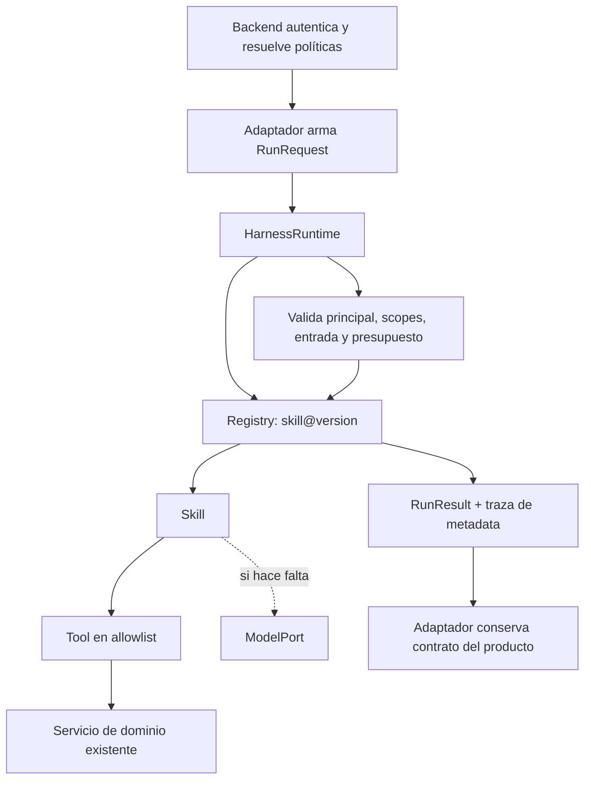

# Arquitectura

[← Índice de documentación](INDEX.md) · [Inicio rápido](QUICKSTART.md)

HarnessOS es un runtime embebible. Coordina procedimientos de IA dentro del backend del producto y delega el acceso a datos a servicios de dominio existentes.

## Recorrido de una solicitud

El runtime no autentica, no contiene rutas HTTP y no reemplaza el orquestador del producto. El adaptador convierte la solicitud existente al contrato interno y traduce el resultado al DTO actual.

## Piezas

| Pieza | Responsabilidad | Implementación de la semilla |
|---|---|---|
| `HarnessRuntime` | Valida contexto y ejecuta una skill bajo límites | `rust/src/core/runtime.rs` |
| `Registry` | Registra skills versionadas y tools con IDs únicos | `rust/src/core/registry.rs` |
| `Principal` | Expresa identidad verificada, tenant y scopes autorizados | `rust/src/core/contracts.rs`; lo construye el backend |
| `Skill` | Valida una entrada y coordina un procedimiento | `rust/src/skills/` |
| `Tool` | Expone una operación autorizada del servicio dueño del dato | `rust/src/adapters/` en la demo |
| `ModelPort` | Permite usar un proveedor de generación cuando la skill lo necesita | Modelo determinista u Ollama local opt-in |
| `RunResult` | Devuelve salida o error tipado con metadata mínima de ejecución | `rust/src/core/contracts.rs` |

## Controles en cada llamada

1. La versión exacta de skill debe existir en el registro.
2. El principal debe venir del backend y contener los scopes requeridos.
3. La skill valida su propia entrada antes de correr.
4. Cada tool debe estar en la allowlist de la skill, tener scope permitido y validar sus argumentos.
5. La cuenta de tools y el timeout no pueden superar los máximos definidos por servidor.
6. La traza registra correlación, skill, versión, cantidad de tools, duración y resultado; omite inputs, prompts, respuestas y documentos.
7. La concurrencia se limita a 8 workers por defecto y se puede ajustar con `RuntimeConfig`; el canal de trabajo no almacena una cola. Cuando todos están ocupados, la ejecución se rechaza.
8. `RuntimeConfig` aplica estimaciones máximas de 1 MiB a entradas, 4 MiB a resultados de tools y 4 MiB a salidas. Las mide antes de pasar el valor a la siguiente etapa.

El timeout cancela mediante `CancellationToken`, pero una dependencia que ignore esa señal puede seguir ejecutándose y ocupar su worker hasta terminar. Por eso la semilla no habilita tools con efectos.

## Capacidades del MVP

| Área | Incluido | No incluido |
|---|---|---|
| Skills | `knowledge.retrieve` y `knowledge.answer`, versionadas | Catálogo remoto o marketplace |
| Búsqueda | Fixture sintética aislada por tenant | Índice vectorial o permisos por documento real |
| Modelo | Respuesta determinista y Ollama local opcional | Router productivo de modelos |
| Memoria | `EphemeralMemory` volátil: 16 MiB de bytes contabilizados, 4096 entradas y 1 KiB por registro por defecto; límites configurables | Persistencia, retención o lifecycle |
| Rutinas | Ninguna | Cola durable, checkpoints, reanudación o idempotencia |
| Transporte | Biblioteca Rust síncrona detrás de un adaptador del backend | Servidor HTTP/SSE público |

## Límites de dependencia

- `rust/src/core` no depende de NestJS, ORM, base de datos ni proveedor LLM.
- El runtime crea workers de forma diferida; por defecto limita a 8 workers y solicita un stack de 256 KiB para cada uno. Estos valores se ajustan con `RuntimeConfig` según el host y la carga.
- `RuntimeConfig` limita valores JSON por etapa con una estimación recursiva de memoria y profundidad máxima 64. El valor ya llegó al proceso cuando se mide; el control no puede impedir allocations internas de una tool o de una biblioteca externa.
- La memoria se asigna bajo demanda. El almacén efímero limita bytes de claves y valores y cantidad de entradas; esto no equivale a un límite exacto de RSS ni a almacenamiento durable.
- Las skills acceden a datos mediante tools; no importan tablas privadas de otro módulo.
- Permisos de negocio y ownership por objeto permanecen en el backend y el servicio de dominio.
- El contenido recuperado es dato no confiable. No puede cambiar scopes ni reglas del runtime.
- HarnessOS no debe convertirse en un segundo orquestador paralelo al producto.

Para la secuencia de integración, ve a [Adopción](ADOPTION.md). Para las estructuras concretas, revisa el [Inicio rápido](QUICKSTART.md).
