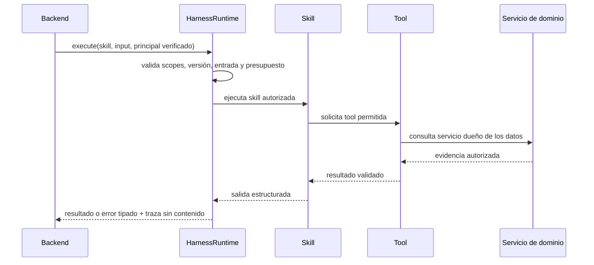

# Inicio rápido

[← Índice de documentación](INDEX.md) · [README](../README.md)

Esta guía te lleva de una demo local a un plan de integración. HarnessOS es una biblioteca Rust para un backend Rust; no levanta un servicio HTTP aparte.

## 1. Ejecuta la demo

Necesitas Rust estable y Cargo. Desde la raíz del repositorio:

```bash
cargo run --release --locked --bin harnessos-demo
cargo test --locked
```

La demo funciona offline. Usa un modelo determinista y documentos inventados. Verás una advertencia de datos ficticios, dos preguntas, respuestas y fuentes con prefijo `DEMO-`.

## 2. Sigue una ejecución



La skill decide el procedimiento; la tool accede a un servicio de dominio; el runtime aplica los límites comunes. El runtime no decide permisos de negocio ni autentica usuarios.

## 3. Adáptalo a tu backend

Empieza con una capacidad de **solo lectura** que ya exista. Mantén intactos el endpoint, DTO, autenticación, cuotas, errores, streaming y persistencia del producto. Consulta [Adopción](ADOPTION.md) antes de cambiar código.

1. **Conecta una tool** al servicio que ya es dueño de los datos. Valida argumentos y limita la consulta a la operación necesaria.
2. **Define una skill** con versión, validador de entrada, scopes requeridos y una allowlist de tools.
3. **Registra componentes** una vez al iniciar la aplicación.
4. **Construye el principal en el servidor**, después de verificar sesión o token y resolver el tenant. Nunca aceptes identidad, scopes o permisos desde el cuerpo del cliente.
5. **Llama al runtime desde un adaptador interno** y convierte su resultado al contrato que ya consume el cliente.
6. **Prueba compatibilidad y rollback** antes de habilitar la ruta mediante una flag controlada por servidor.

La llamada interna tiene esta forma:

```ts
let result = runtime.execute(RunRequest {
    skill_id: "knowledge.retrieve".to_owned(),
    version: "1.0.0".to_owned(),
    input: serde_json::json!({ "question": existing_request.message }),
    principal: principal_from_verified_server_auth(existing_request)?,
    correlation_id: existing_request.id.clone(),
    requested_budget: None,
});

match result {
    RunResult::Failure { error, .. } => map_harness_error_to_existing_contract(error),
    RunResult::Success { output, .. } => map_output_to_existing_dto(output),
}
```

Los nombres `principal_from_verified_server_auth`, `map_harness_error_to_existing_contract` y `map_output_to_existing_dto` representan funciones de tu aplicación, no APIs incluidas aquí. El presupuesto máximo lo fija el servidor; una llamada puede reducirlo, nunca ampliarlo. Este ejemplo es Rust; otro lenguaje necesita un adaptador propio, que este repositorio no incluye.

## 4. Revisa el código

Cargo resuelve las dependencias fijadas por `Cargo.lock`:

```bash
cargo fmt --check
cargo check --all-targets --locked
cargo test --locked
```

## Qué demuestra el ejemplo y qué no

Las pruebas cubren ejecución, scopes, allowlist, aislamiento por tenant, abstención sin evidencia, límites de memoria, concurrencia, timeout y fuentes ficticias. No miden calidad de un LLM ni representan persistencia. Para usar Ollama local, sigue las instrucciones opcionales del [README](../README.md#probar-con-ollama-opcional).

El runtime usa 8 workers por defecto, con stack solicitado de 256 KiB; `RuntimeConfig` permite ajustarlos. También limita por estimación la entrada (1 MiB), cada resultado de tool (4 MiB) y la salida (4 MiB). La memoria efímera tiene un máximo configurable, de 16 MiB contabilizados por defecto. Estos límites no equivalen a un techo exacto de RSS ni impiden asignaciones internas de una tool. HarnessOS no reserva toda la RAM disponible; ajusta los límites con una carga representativa del PC o VPS. Antes de producción hacen falta autenticación y políticas reales, evaluación de calidad, privacidad y retención, observabilidad, cancelación cooperativa y rollback. La memoria de ejemplo vive en RAM y no es apta para datos personales.
