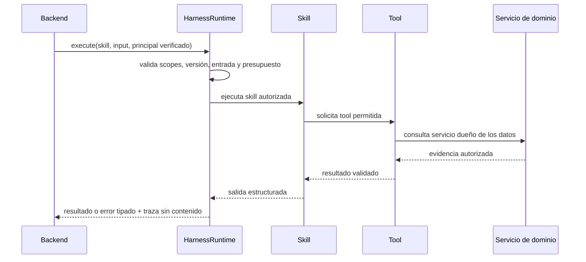

# Inicio rápido

[← Índice de documentación](INDEX.md) · [README](../README.md)

Esta guía te lleva de una demo local a un plan de integración. HarnessOS es una biblioteca TypeScript que corre dentro de tu backend; no levanta un servicio HTTP aparte.

## 1. Ejecuta la demo

Necesitas Node.js **22.10 o superior**. Desde la raíz del repositorio:

```bash
npm run demo
npm test
```

La demo funciona offline. Usa un modelo determinista y documentos inventados. Verás una advertencia de datos ficticios, dos preguntas, respuestas y fuentes con prefijo `DEMO-`. El smoke test ejecuta el mismo comando y comprueba esa salida.

## 2. Sigue una ejecución



La skill decide el procedimiento; la tool accede a un servicio de dominio; el runtime aplica los límites comunes. El runtime no decide permisos de negocio ni autentica usuarios.

## 3. Adáptalo a tu backend

Empieza con una capacidad de **solo lectura** que ya exista. Mantén intactos el endpoint, DTO, autenticación, cuotas, errores, streaming y persistencia del producto. Consulta [Adopción](ADOPTION.md) antes de cambiar código.

1. **Conecta una tool** al servicio que ya es dueño de los datos. Valida argumentos y limita la consulta a la operación necesaria.
2. **Define una skill** con versión, validador de entrada, scopes requeridos y una allowlist de tools.
3. **Registra componentes** una vez al iniciar la aplicación.
4. **Construye el principal en el servidor**, después de verificar sesión o token y resolver el tenant. Nunca aceptes identidad, scopes o permisos desde el cuerpo del cliente.
5. **Llama al runtime desde un adaptador interno** y convierte su resultado al contrato que ya consume el cliente.
6. **Prueba compatibilidad y rollback** antes de habilitar la ruta mediante una flag controlada por servidor.

La llamada interna tiene esta forma:

```ts
const result = await runtime.execute({
  skillId: "knowledge.retrieve",
  version: "1.0.0",
  input: { question: existingRequest.message },
  principal: principalFromVerifiedServerAuth(request),
  correlationId: existingRequestId,
});

if (!result.ok) {
  return mapHarnessErrorToExistingContract(result.error);
}

return mapOutputToExistingDto(result.output);
```

Los nombres `principalFromVerifiedServerAuth`, `mapHarnessErrorToExistingContract` y `mapOutputToExistingDto` representan funciones de tu aplicación, no APIs incluidas aquí. El presupuesto máximo lo fija el servidor; una llamada puede reducirlo, nunca ampliarlo.

## 4. Corre el typecheck

La demo y las pruebas no necesitan paquetes. El chequeo completo también requiere TypeScript, declarado como dependencia de desarrollo:

```bash
npm install --no-audit --no-fund
npm run check
```

## Qué demuestra el ejemplo

La prueba local cubre ejecución, scopes, allowlist, aislamiento por tenant, abstención sin evidencia y respuesta legible con fuentes ficticias. No mide calidad de un LLM ni representa persistencia. Para usar Ollama local, sigue las instrucciones opcionales del [README](../README.md#probar-con-ollama-opcional).

Antes de producción hacen falta autenticación y políticas reales, evaluación de calidad, privacidad y retención, observabilidad, cancelación cooperativa y rollback. La memoria de ejemplo vive en RAM y no es apta para datos personales.
